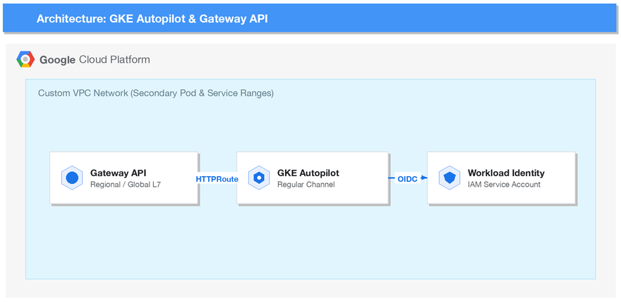

# intro
Create a GKE Autopilot cluster in a custom VPC with Workload Identity Federation for GKE and built-in Gateway API support.

## Architecture
Below is an architectural image created after Terraform is executed.

