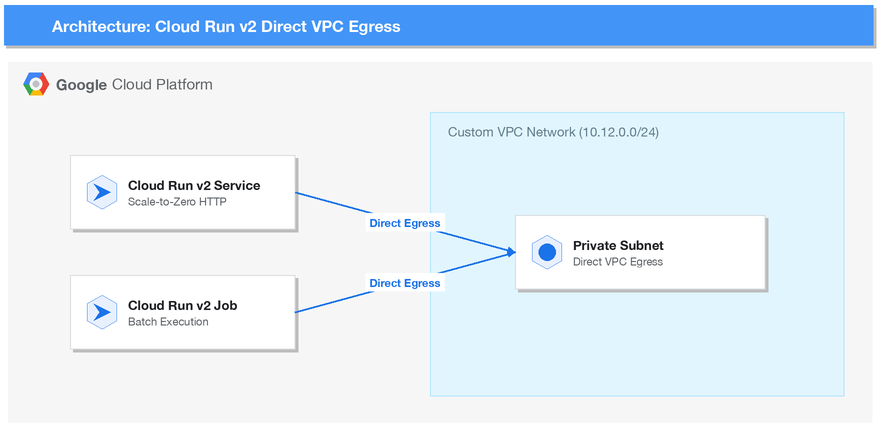

# intro
Create a Cloud Run v2 Service and Cloud Run v2 Job connected directly to a custom VPC subnet using Direct VPC Egress (without a Serverless VPC Access Connector).

## Architecture
Below is an architectural image created after Terraform is executed.

