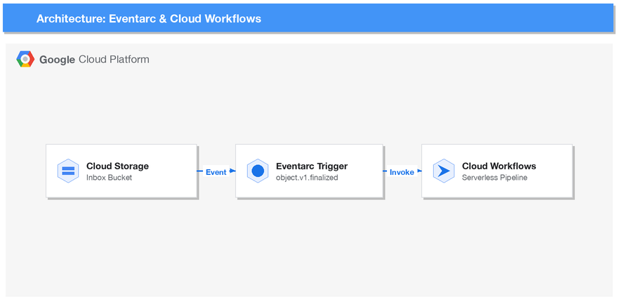

# intro
Create an event-driven serverless orchestration pipeline where uploading an object to Cloud Storage triggers Cloud Workflows via Eventarc.

## Architecture
Below is an architectural image created after Terraform is executed.

