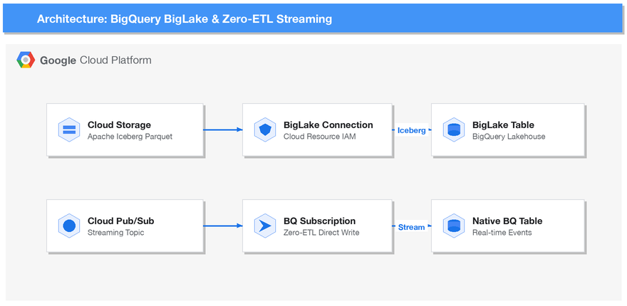

# intro
Create a modern BigQuery + BigLake Lakehouse over Cloud Storage (Apache Iceberg) and a Zero-ETL Pub/Sub BigQuery Direct Subscription for real-time streaming ingestion.

## Architecture
Below is an architectural image created after Terraform is executed.

