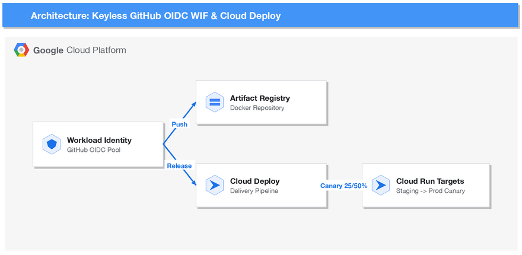

# intro
Create a Keyless CI/CD pipeline using GitHub Actions OIDC Workload Identity Federation (no JSON service account keys), Artifact Registry, and Cloud Deploy Canary delivery to Cloud Run.

## Architecture
Below is an architectural image created after Terraform is executed.

