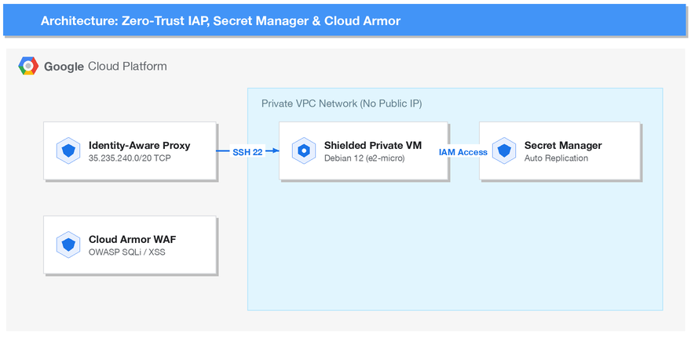

# intro
Create a Zero-Trust architecture featuring a private VM (no public IP) accessed via Identity-Aware Proxy (IAP) TCP Tunneling, Secret Manager secret injection, and a Cloud Armor WAF security policy.

## Architecture
Below is an architectural image created after Terraform is executed.

