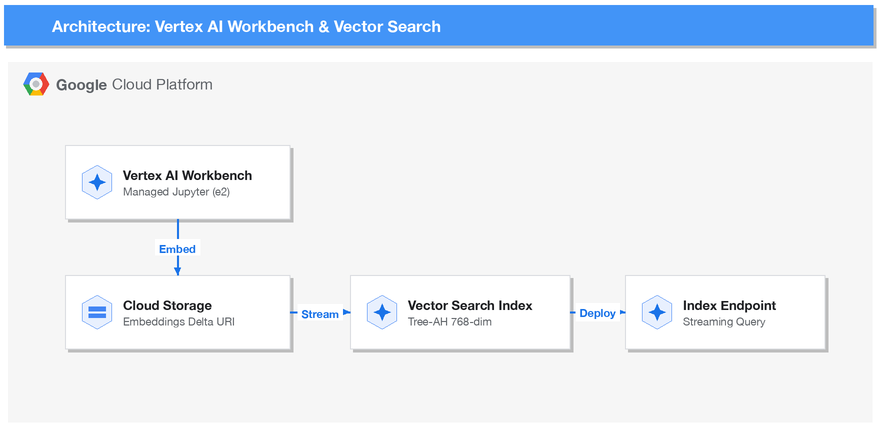

# intro
Create a Vertex AI platform foundation including a Vertex AI Workbench instance, a Cloud Storage embeddings bucket, and a Vertex AI Vector Search streaming index & endpoint.

## Architecture
Below is an architectural image created after Terraform is executed.

