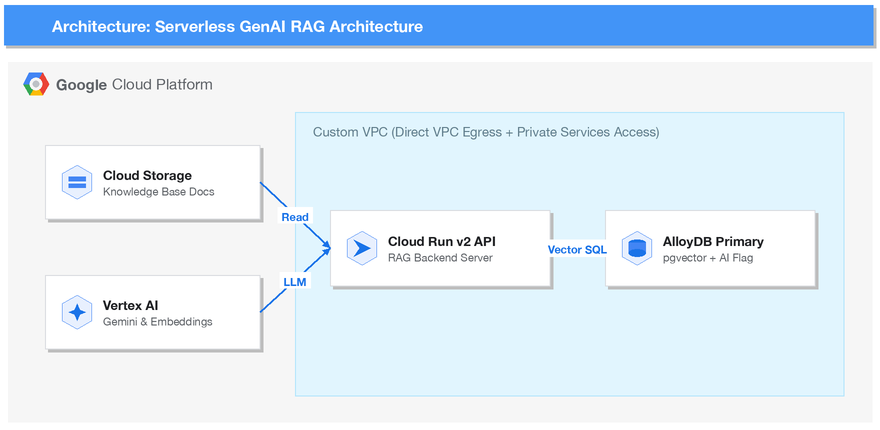

# Build a Serverless GenAI RAG Server with Cloud Run v2, AlloyDB (pgvector), and Vertex AI

This sample provisions a modern Serverless Retrieval-Augmented Generation (RAG) architecture on Google Cloud:
- **Cloud Storage**: Document ingestion bucket for PDFs / markdown knowledge bases
- **AlloyDB for PostgreSQL**: Vector store (`pgvector` & AlloyDB AI integration) in a private VPC via Private Services Access
- **Cloud Run v2 (Direct VPC Egress)**: RAG API server reaching AlloyDB over private IP without a VPC Access Connector, granted `roles/aiplatform.user` to invoke **Vertex AI (Gemini & Text Embeddings)**
- **Artifact Registry**: Private Docker repository for the RAG backend image
