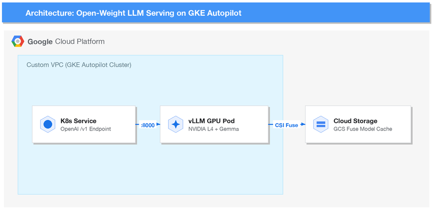

# Open-Weight LLM Serving on GKE Autopilot (vLLM + NVIDIA L4 GPU + GCS Fuse CSI)


This sample provisions a GKE Autopilot cluster and a Cloud Storage model weights bucket wired via Workload Identity Federation for GKE, ready to serve open-weight LLMs (e.g., Gemma 3 / Llama) with **vLLM**, **NVIDIA L4 GPUs**, and **Cloud Storage FUSE CSI** zero-copy weight loading.

## 1. Provision Infrastructure with Terraform

```bash
export TF_VAR_project_id="your-project-id"
terraform init
terraform apply
```

## 2. Connect to Cluster & Deploy vLLM

```bash
gcloud container clusters get-credentials llm-serving-cluster --region us-central1

# Update <PROJECT_ID> and <MODEL_BUCKET> in vllm-deployment.yaml, then apply:
kubectl apply -f vllm-deployment.yaml
```

## 3. Test OpenAI-Compatible Chat Completions Endpoint

```bash
kubectl port-forward svc/vllm-gemma-service 8000:8000

curl http://localhost:8000/v1/completions \
  -H "Content-Type: application/json" \
  -d '{
    "model": "google/gemma-2-2b-it",
    "prompt": "Explain Terraform modules in two sentences.",
    "max_tokens": 128
  }'
```

## Cleanup

```bash
kubectl delete -f vllm-deployment.yaml --ignore-not-found
terraform destroy
```
